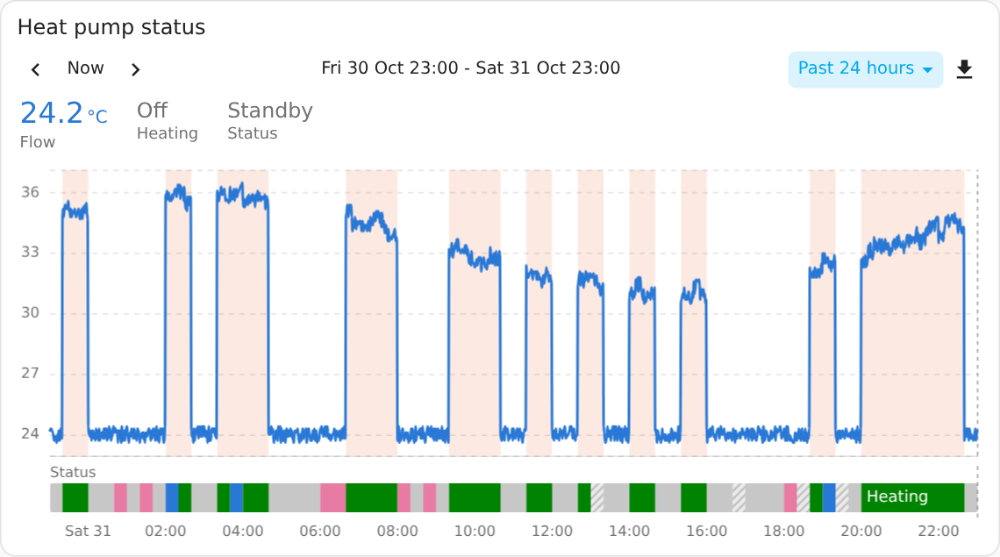
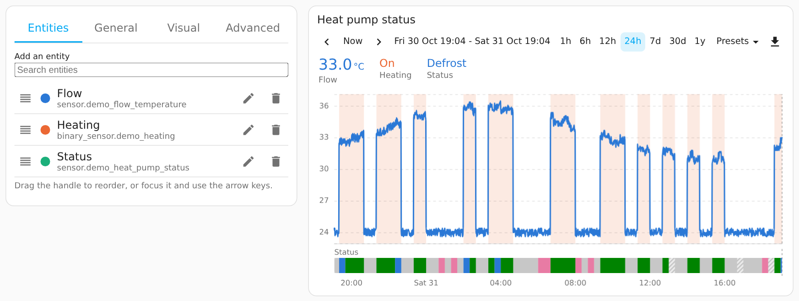

# Chart Explorer Card

[](https://ko-fi.com/corautem)

A Home Assistant dashboard card for exploring history: lines, stacked areas, bars, pies and hour-by-day heatmaps, with on/off and status entities as coloured strips. A one-row toolbar picks the time window, you drag and pinch to move through time, and the download button saves what is shown as CSV or PNG.



## Features

- **Eight ways to draw history:** lines, stacked areas, bars per hour, day, week or month, pie, donut, heatmaps of numbers or of states, and timeline strips or shaded bands for entities such as a heat pump status or a door.
- **Time controls in one row:** buttons from 1 hour to 1 year, presets such as Today or Last month, previous and next, and a custom range.
- **Drag to move, pinch to zoom:** the card loads finer data as you zoom in; a double-tap goes back.
- **Values that follow the cursor:** each entity's value sits above the chart in its colour; tap a name to fade that entity.
- **Export:** a CSV of exactly what is shown, or a PNG with the title and legend.
- **Visual editor** for every setting, and **light by default:** only the chart parts in use are bundled, animations are off, and nothing redraws while the card is off-screen.

It brings a time-range toolbar, zooming and export into a dashboard card, so history can be browsed without leaving the dashboard. Charts are drawn with [Apache ECharts](https://echarts.apache.org/) 6. Version 0.6.2 is the first public release.

## Chart types


| `chart_type` | Draws |
|---|---|
| `line` (default) | One line per entity. Entities with states draw as strips under the chart, or as shaded bands behind the lines. |
| `area` | The lines stacked as filled areas. |
| `bar` | One bar per hour, day, week or month; meters show how much they rose. |
| `pie`, `donut` | Each entity's share of the window; an entity with states gets a pie of the time spent in each state. |
| `heatmap` | One entity, days across and hours down, each hour coloured by its value or by the state that held longest. |

A picture and an example for each: [Chart types](docs/chart-types.md).

## Installing

### HACS

1. In Home Assistant, open **HACS**, then the three-dot menu → **Custom repositories**.
2. Paste `https://github.com/corautem/chart-explorer-card`, choose the type **Dashboard**, and select **Add**.
3. Find **Chart Explorer Card** in HACS, open it and select **Download**. HACS adds the resource entry.
4. Reload the browser.

<details>
<summary><b>By hand</b></summary>

1. Download both files from the [latest release](https://github.com/corautem/chart-explorer-card/releases/latest): `chart-explorer-card.js` (the card) and `chart-explorer-card-editor.js` (the visual editor, loaded only when you edit a card).
2. Copy them into your Home Assistant configuration folder, in `/config/www/chart-explorer-card/`.
3. In Home Assistant, open **Settings → Dashboards**, then the three-dot menu → **Resources** → **Add resource**. (The Resources entry appears only with **Advanced mode** on in your user profile.)
   - URL: `/local/chart-explorer-card/chart-explorer-card.js?v=0.6.2`
   - Type: **JavaScript module**
4. Reload the browser.

When you copy a newer release, raise the `?v=` number in the resource URL so browsers fetch the new files. The editor file is loaded with the same number, so only the card needs a resource entry.

</details>

## Getting started

Add **Chart Explorer Card** from the card picker and choose entities in the visual editor, or start from YAML:

```yaml
type: custom:chart-explorer-card
title: Heating
entities:
  - sensor.flow_temperature
  - sensor.return_temperature
  - binary_sensor.heating
```



The editor saves only what differs from the defaults, so the YAML stays short. Every option is listed in [Options](docs/options.md).

## Using the card

- **Toolbar:** ‹ › move the window by its own length, Now returns to the present, the buttons and the Presets menu pick a window, the dates open a custom range, and the download button saves a CSV or PNG.
- **Moving and zooming:** drag sideways to move through time; pinch, or hold Ctrl and use the mouse wheel, to zoom; hold Shift and drag to zoom into a part; double-click or double-tap to go back.
- **Values:** hover over or tap the chart to see the readings at that moment; tap a value for the entity's details; tap a name to fade the entity and leave it out of the CSV.

More on each control: [Using the card](docs/usage.md).

## Examples

<details>
<summary><b>Heating with a shaded band and the heat pump status</b></summary>

```yaml
type: custom:chart-explorer-card
title: Heat pump
entities:
  - entity: sensor.flow_temperature
    name: Flow
  - entity: binary_sensor.heating
    name: Heating
    type: band
  - entity: sensor.heat_pump_status
    name: Status
    state_colors:
      standby: "#9e9e9e"
```

</details>

<details>
<summary><b>Energy per day this week</b></summary>

```yaml
type: custom:chart-explorer-card
title: Energy per day
chart_type: bar
default_range: this_week
entities:
  - entity: sensor.heat_pump_energy
    name: Heat pump
  - entity: sensor.hot_water_energy
    name: Hot water
```

</details>

<details>
<summary><b>A week of status, hour by hour</b></summary>

```yaml
type: custom:chart-explorer-card
title: Heat pump status by hour
chart_type: heatmap
default_range: 7d
entities:
  - entity: sensor.heat_pump_status
    name: Status
```

</details>

<details>
<summary><b>A clean card: values only, toolbar at the bottom without dates</b></summary>

```yaml
type: custom:chart-explorer-card
toolbar_position: bottom
show_range_label: false
show_names: false
entities:
  - sensor.living_room_temperature
```

</details>

## Troubleshooting

- **The card or the editor still shows an older version.** Reload the browser. If you installed by hand, raise the `?v=` number in the resource URL.
- **An entity with states draws as a line.** Set `type: timeline` on it. The card decides from the entity's attributes and history, and a sensor that reports numbers is drawn as a line.
- **Older history looks smoother than recent history.** For entities with long-term statistics, windows longer than 24 hours are drawn from 5-minute, hourly, daily or weekly averages instead of every recorded change. See [Data and export](docs/data-and-export.md).
- **A timeline or a heatmap of states stops after some days.** States come from raw history, which the recorder keeps for 10 days unless `purge_keep_days` is changed.

## Documentation

- [Chart types](docs/chart-types.md): a picture and an example for each chart type, entities with states, bands and state colours.
- [Using the card](docs/usage.md): the toolbar, the values row, moving and zooming.
- [Options](docs/options.md): every card and entity option, and the visual editor's tabs.
- [Data and export](docs/data-and-export.md): where the data comes from, and what the CSV and PNG contain.
- [Development](docs/development.md): building and testing the card.

## Support

I build Chart Explorer Card in my spare time. If it's useful to you, a star on GitHub (the Star button at the top of the repository page) helps other people find it. If you'd like to support the work, you can do so through [GitHub Sponsors](https://github.com/sponsors/corautem) or on [Ko-fi](https://ko-fi.com/corautem). Bug reports and ideas are welcome in the issues.

## Licence

Copyright (C) 2026 the Chart Explorer Card contributors.

Chart Explorer Card is free software: you can redistribute it and/or modify it under the terms of the GNU General Public License as published by the Free Software Foundation, either version 3 of the License, or (at your option) any later version. It is distributed in the hope that it will be useful, but without any warranty; see the [GNU General Public License](LICENSE) for details.

The built files include [Apache ECharts](https://github.com/apache/echarts) (Apache License 2.0, with code from [d3](https://github.com/d3/d3) under the BSD 3-Clause License), [ZRender](https://github.com/ecomfe/zrender) and [Lit](https://github.com/lit/lit) (BSD 3-Clause License), [tslib](https://github.com/microsoft/tslib) (0BSD) and icon paths from [Material Design Icons](https://github.com/Templarian/MaterialDesign) (Apache License 2.0). Their licence texts are in [THIRD-PARTY-NOTICES.md](THIRD-PARTY-NOTICES.md), and a short notice sits at the top of each built file.
