# Chart types

`chart_type` picks the kind of chart; lines are the default. Entities whose states are words, such as a heat pump status or a door, draw as timeline strips or shaded bands in line, area and bar charts, and get pies and heatmaps of their own.

| `chart_type` | What it draws |
|---|---|
| `line` | One line per entity over time. |
| `area` | The lines stacked as filled areas, each on top of the one before; entities on the same scale add up, such as the power of several circuits. |
| `bar` | One bar per hour, day, week or month (`period`, automatic by default). Meters such as energy show how much they rose in each bar; other entities their average. `stacked: true` stacks the bars instead of standing them side by side. |
| `pie`, `donut` | Each entity's share over the window: meters by how much they rose, other entities by their average. An entity with states gets a pie of its own showing the time spent in each state. |
| `heatmap` | One entity, the days of the window across and the hours of the day down. For a number, each hour is coloured by its value (for a meter, how much it rose in that hour), with a colour key from lowest to highest under the chart. For an entity with states, each hour takes the colour of the state that held longest in it, and the key lists the states. It shows the first entity that is not faded, so tapping names chooses which. |

The entity IDs below are examples; use your own.

## Lines

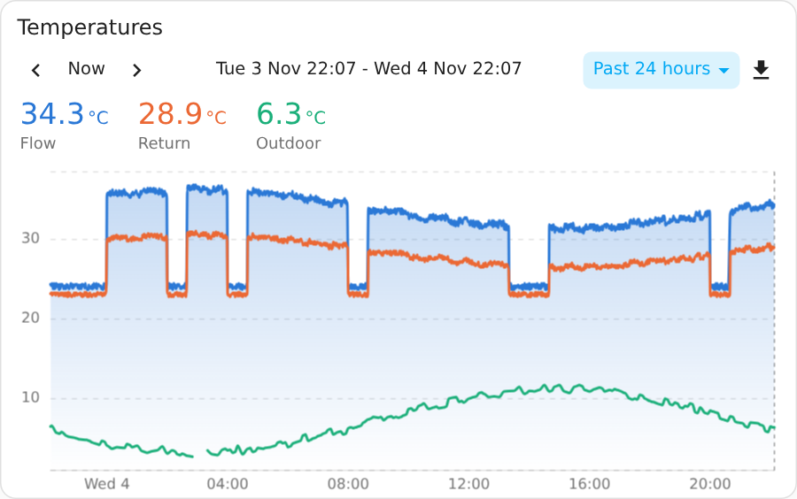

```yaml
type: custom:chart-explorer-card
title: Temperatures
default_range: 24h
entities:
  - entity: sensor.flow_temperature
    name: Flow
    fill: true
  - entity: sensor.return_temperature
    name: Return
  - entity: sensor.outdoor_temperature
    name: Outdoor
```

Entities can also be listed as plain IDs: `entities: [sensor.flow_temperature, sensor.return_temperature]`. Entities with different units get their own scales: the first unit on the left, the second on the right.

## Stacked areas

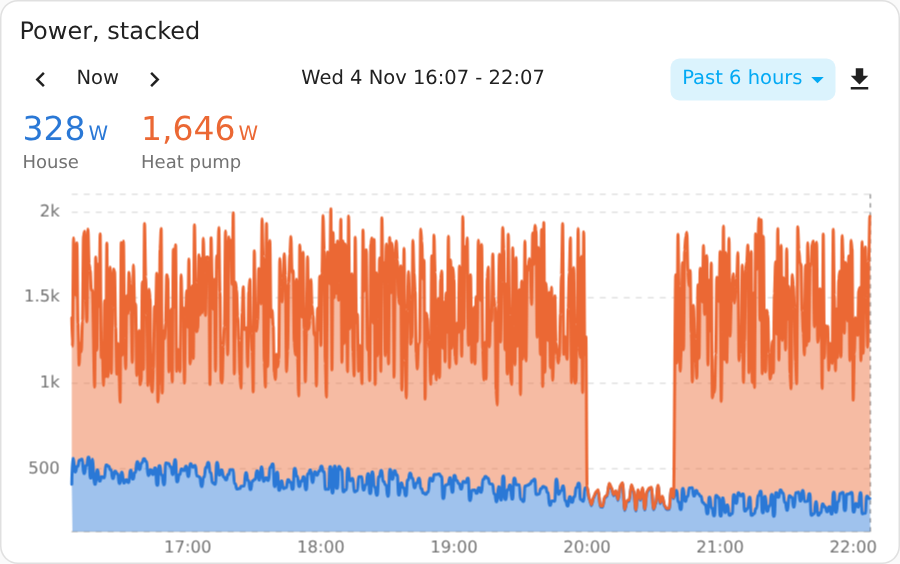

```yaml
type: custom:chart-explorer-card
title: Power, stacked
chart_type: area
default_range: 6h
entities:
  - entity: sensor.house_power
    name: House
  - entity: sensor.heat_pump_power
    name: Heat pump
```

## Bars

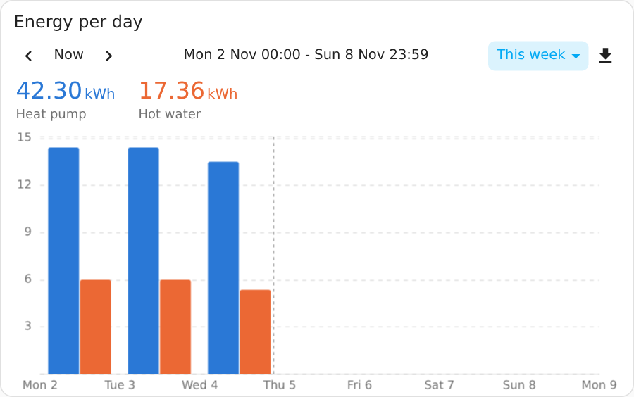

```yaml
type: custom:chart-explorer-card
title: Energy per day
chart_type: bar
default_range: this_week
entities:
  - entity: sensor.heat_pump_energy
    name: Heat pump
  - entity: sensor.hot_water_energy
    name: Hot water
```

Automatic bar lengths are hours for windows up to two days, days up to 45 days, weeks up to 200 days, then months; `period` fixes one. The values row shows the total of the bars on screen for a meter, and the bar under the cursor while you hover.

### Ratios, such as a heat pump's COP

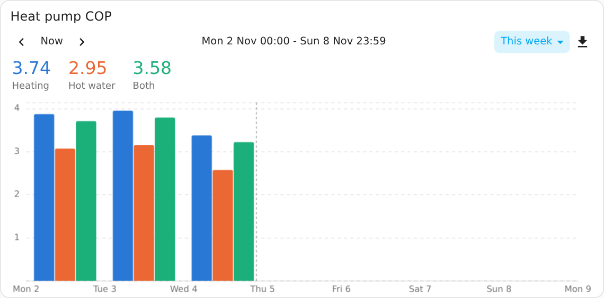

`divide_by` turns a meter into a ratio: each bar is the meter's rise in that period divided by the rise of the meters named in `divide_by`, added together. A heat pump's heat delivered divided by its electricity used gives its coefficient of performance (COP). `add` names further meters added to the entity's rise first, such as hot water to space heating.

```yaml
type: custom:chart-explorer-card
title: Heat pump COP
chart_type: bar
period: day
default_range: this_week
entities:
  - entity: sensor.heat_pump_heat_space_heating
    divide_by: sensor.heat_pump_electricity_space_heating
    name: Heating
  - entity: sensor.heat_pump_heat_hot_water
    divide_by: sensor.heat_pump_electricity_hot_water
    name: Hot water
  - entity: sensor.heat_pump_heat_space_heating
    add: [sensor.heat_pump_heat_hot_water]
    divide_by: [sensor.heat_pump_electricity_space_heating, sensor.heat_pump_electricity_hot_water]
    name: Both
```

- **Window value:** the values row shows the ratio over the whole window: the sum of the meters' rises divided by the sum of the divisors' rises, never the average of the bars. While you hover, the bar under the cursor.
- **Units:** each meter is converted before adding up and dividing, so Wh and kWh mix. Units of one family give a plain number, shown without a unit unless `unit` sets one, such as `COP`; others give a unit such as kWh/m³. Ratios show two decimal places unless `decimals` says otherwise.
- **Quiet periods:** a bar stays empty when the divisor rose less than `min_divisor` in that period (in the first divisor's unit), so a nearly idle day shows no absurd ratio. Without it the minimum is 50 Wh (0.05 kWh) for energy meters, and anything above zero for other units.
- **Signs:** a meter that dips, such as heat delivered during a defrost, lowers its period's rise.
- **Meters only:** the entity, the meters it adds and its divisors must be meters with a running total (a state class of total or total increasing). A measurement, such as power in W, leaves the row empty, and the card says which entity it is.
- **Line charts** show the ratio so far: at the end of each period, the ratio from the window start ("COP so far today"), ending at the window value. `type: line` draws it over a bar chart too. Stacked areas and stacked bars never stack ratios, and pies, donuts and heatmaps leave them out.

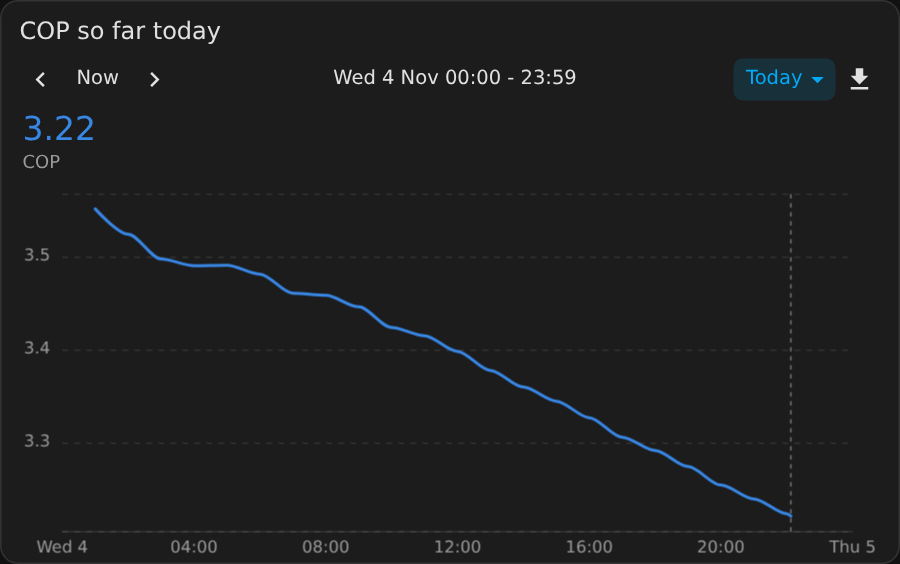

## Pie and donut

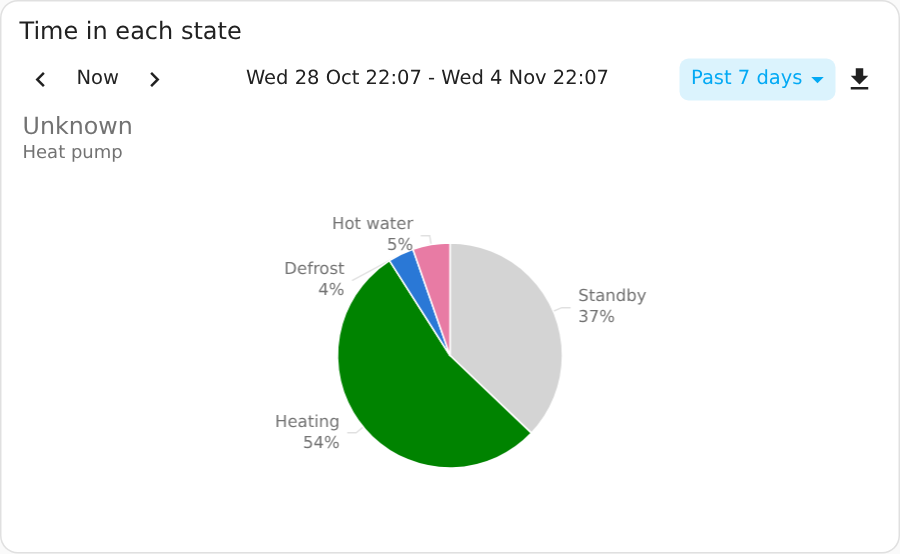

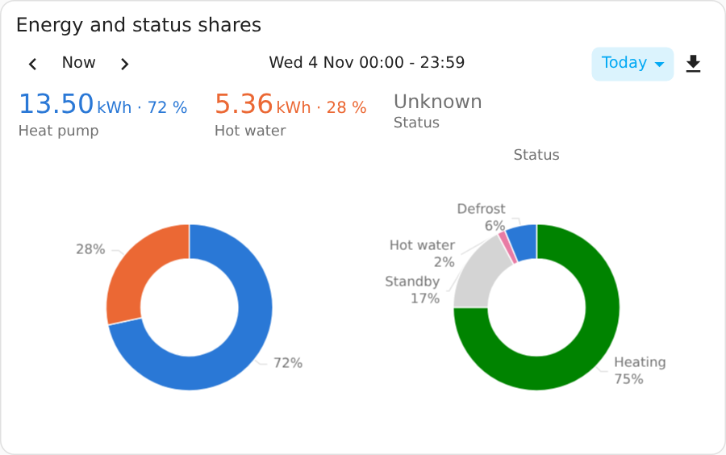

```yaml
type: custom:chart-explorer-card
title: Energy and status shares
chart_type: donut
default_range: today
entities:
  - entity: sensor.heat_pump_energy
    name: Heat pump
  - entity: sensor.hot_water_energy
    name: Hot water
  - entity: sensor.heat_pump_status
    name: Status
```

The numbers share one pie; each entity with states gets its own, named above it. Values in W and kW (or Wh and kWh) are compared in one unit, so a charger in kW and a heater in W get their true shares; each value above the chart keeps its own unit. For other units, `multiply` brings a value into line, such as `multiply: 1000` with `unit: W` for a sensor in kW. Each value in the row shows its share. Tap a slice to open the entity's details. Pies have no time axis, so dragging and zooming do nothing; the toolbar picks the window.

## Heatmaps

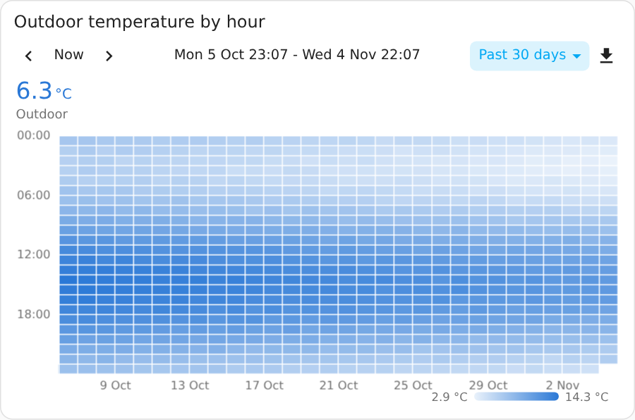

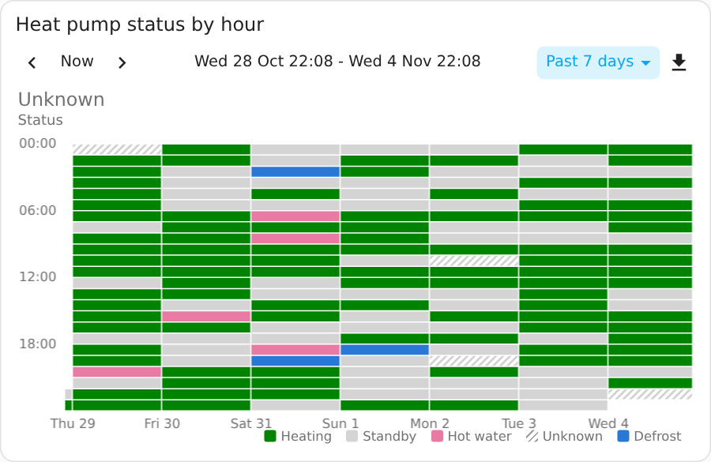

```yaml
type: custom:chart-explorer-card
title: Heat pump status by hour
chart_type: heatmap
default_range: 7d
entities:
  - entity: sensor.heat_pump_status
    name: Status
```

Hovering a cell shows that hour's value. For an entity with states it shows the state that held longest in that hour, followed by the minutes in each state, such as `Heating 40 min · Standby 20 min`. A state that lasts a few minutes, such as a short defrost, colours an hour only when nothing else lasted longer in it.

## Forecasts and other lists from attributes

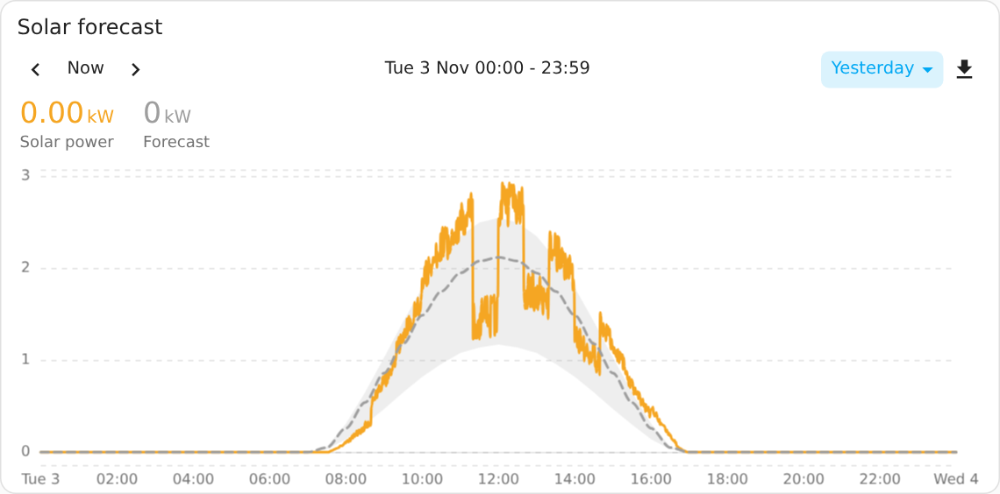

Some integrations keep a list in an attribute instead of in the recorded history. Solcast and Predbat keep the solar forecast in `detailedForecast`: half-hour slots, each with `period_start`, the estimate `pv_estimate` in kW, and a low and a high estimate, `pv_estimate10` and `pv_estimate90`. Such a list is drawn as it is now, including the times still to come, instead of the entity's recorded history.

**In the editor:** open the entity and set **Draw from** to the attribute. **Values to draw** then lists every number in the items. Switch on the ones to draw; each gets its own name, colour, line type (solid, dashed, dotted or none) and fill: none, down to zero, or up to another value. Filling one value up to another shades the range between them; with line type None only the shading shows.

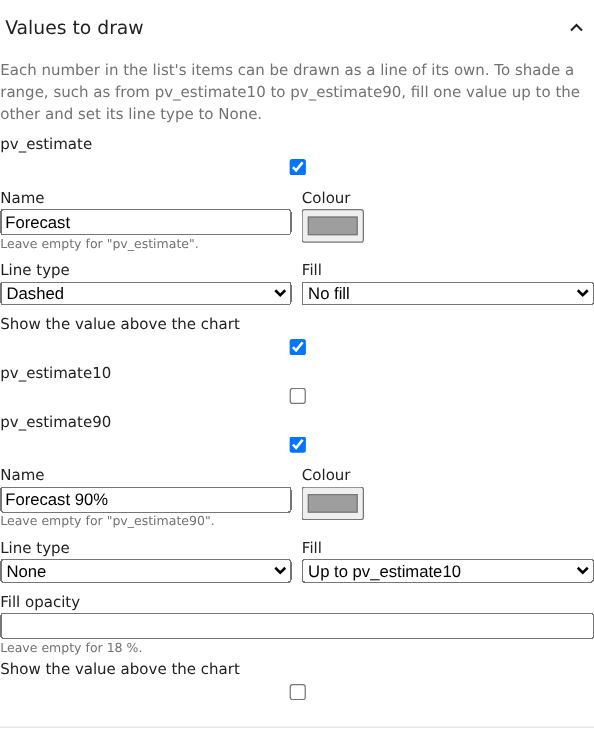

The same in YAML:

```yaml
type: custom:chart-explorer-card
title: Solar forecast
default_range: today
entities:
  - entity: sensor.solar_power
    name: Solar power
  - entity: sensor.pv_forecast_today
    attribute:
      name: detailedForecast
      values:
        - key: pv_estimate
          name: Forecast
          line_style: dashed
        - key: pv_estimate90
          name: Forecast 90%
          line_style: none
          fill: pv_estimate10
          show_in_header: false
```

| Key | What it is |
|---|---|
| `name` | The attribute that holds the list. |
| `time` | The key with each item's time, as ISO text or epoch seconds or milliseconds. Found automatically when it is `period_start`, `start`, `start_time`, `datetime`, `time`, `from` or `date`. |
| `values` | The numbers to draw, each a line of its own with `key` and optionally `name`, `color`, `line_style`, `fill` (`zero`, or another key to shade the range up to it), `fill_opacity` (0 to 1) and `show_in_header`. Without `values`, the list's only number is drawn. |

Items can also be `[time, value]` pairs, and the attribute can be a map of times to values, such as Predbat's `results`. The editor offers both with a single value called `value`; in YAML, `values: [{ key: value }]`. The form from version 0.8.0 (`value`, `low` and `high`) still works.

- **Unit:** a list has no unit of its own. When the entity's unit is kWh (or Wh, MWh), the list is shown in kW (W, MW), because forecast slots hold power; otherwise set `unit` on the entity.
- **Scales:** values in W and kW (or Wh and kWh) share one scale, in the unit of the first entity that has one; the others are converted for drawing, and their values above the chart keep their own unit. A solar power sensor in W and a forecast in kW draw on one scale.
- **Values row:** each value shows its reading now, and at the cursor, before or after the present. `show_in_header: false` keeps a value off the row, such as one used only for shading.
- **Updates:** the chart redraws when the attribute changes. No history is requested for these values.
- Lists are drawn in line, area and bar charts; pies and heatmaps leave them out.

### Areas without a line

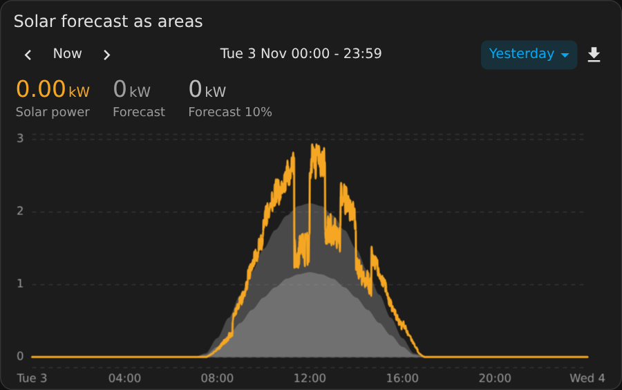

Line type None and a fill down to zero draw each value as a see-through area, with `fill_opacity` for an even fill instead of one that fades downwards:

```yaml
  - entity: sensor.pv_forecast_today
    color: "#9e9e9e"
    attribute:
      name: detailedForecast
      values:
        - key: pv_estimate
          name: Forecast
          line_style: none
          fill: zero
          fill_opacity: 0.35
        - key: pv_estimate10
          name: Forecast 10%
          color: "#bdbdbd"
          line_style: none
          fill: zero
          fill_opacity: 0.35
```

## Entities with states

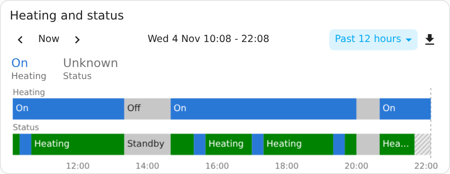

Entities whose states are words, such as `binary_sensor`, `switch`, `climate` or a sensor that reports `standby` or `hot_water`, draw as a strip under the chart in line, area and bar charts. Each part of the strip is coloured by its state, with the state written inside where it fits, and the entity's name above the strip. The strips share the time axis with the chart, so dragging, zooming and the cursor work across both. A card with only such entities shows just the strips.

The card tells numbers from states by the entity's attributes and its current state. A sensor that is unavailable or unknown when the card loads is judged by its recorded history instead.

### Bands

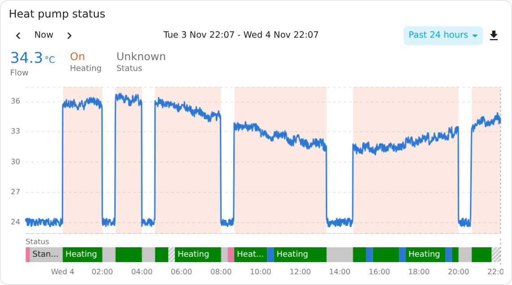

An entity can choose how it is drawn with `type`: `line`, `bar`, `timeline` or `band`. A band shades the chart behind the lines while the entity is on, for example heating on and off under a temperature line. `on_states` picks which states shade it; by default every state except off, idle, standby and the like.

```yaml
type: custom:chart-explorer-card
title: Heat pump
entities:
  - entity: sensor.flow_temperature
    name: Flow
  - entity: binary_sensor.heating
    name: Heating
    type: band
  - entity: sensor.heat_pump_status
    name: Status
    state_colors:
      standby: "#9e9e9e"
```

### State colours

A state keeps its colour in every window and on every device. `on` uses the entity's colour, and quiet states (off, idle, standby, closed, not_home and the like) are grey. States an entity lists as options take the palette colours in that order; any other state gets a palette colour picked from its name. Unavailable and unknown stretches are striped, so they never look like a grey state.

`state_colors` sets a colour for any state, unavailable and unknown included. In the editor, the entity page's State colours group has a picker for each state. It lists the entity's own list of states first (if it has one, in that order), then the states it is in now or was in during the last 30 days, A to Z, then Unavailable and Unknown. A state that has not happened in that time can be added by typing its name as Home Assistant records it.
