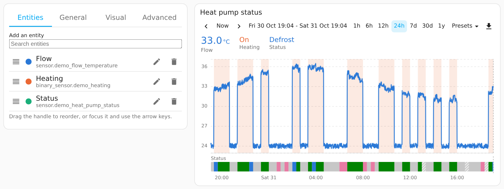

# Options

The visual editor covers every option except those marked YAML only. In YAML, only `type` and `entities` are required.

## Visual editor

Edit the card from the dashboard editor like any built-in card. The editor has four tabs:

| Tab | What it holds |
|---|---|
| Entities | A search box at the top adds an entity. Below it, the entities in order, each with its colour: drag the handle to reorder (or focus it and use the arrow keys), the pencil opens the entity's settings in one scroll, and the bin removes. The entity page shows Divide by (with the meters to add and the smallest divisor once it is set) for a ratio, where the line comes from (Draw from: the recorded history, or a list in one of the entity's attributes, with the keys in each item) and how the entity is drawn (Draw as): line shape, type, width and fill for lines; the states that shade a band; a colour picker per state for timelines and bands (states from the last 30 days, and any you add); then name, colour, show in the values row, show the name, show unit, unit, decimal places, scale and the value drawn on long windows. |
| General | Title, chart type, starting window and what dragging the chart does, then folding groups: Bars (length of each bar, stacking; shown for bar charts), Quick ranges (the seven standard lengths at the top of the Presets menu; tap to show or hide), Menu entries (the nine presets, the same way) and Toolbar (position top, bottom or off, and a switch for each control). Quick ranges add lengths with "Past [number] [unit] Add length"; menu entries choose Past or Next, so a length can run into the future ("Next day"). Added lengths follow the standard ones in an amber shade, switch on and off, and × deletes them. |
| Visual | Folding groups: values (above or below the chart, row alignment, value position, name alignment, value and name text size, space between values, show names), chart (faded line opacity, the now line, floating tooltip, rescaling), height and space inside the chart, timeline strips (strip height, names above the strips, states written inside), x-axis (time labels, their size, vertical grid lines) and y-axis (value labels, their size, units above the axes, starting at zero, horizontal grid lines). |
| Advanced | Lightweight mode and animations, data sources, the value drawn on long windows for every entity, CSV export. Each setting has an explanation under it. |

The editor saves only what differs from the defaults, so the YAML stays short, and it keeps any option it does not show.

## Card options

| Option | Default | Description |
|---|---|---|
| `entities` | required | List of entities (see below). |
| `title` | none | Card title. |
| `chart_type` | `line` | `line`, `area` (stacked), `bar`, `pie`, `donut` or `heatmap`. See [Chart types](chart-types.md). |
| `period` | `auto` | Length of each bar: `hour`, `day`, `week` or `month`. Automatic uses hours for windows up to two days, days up to 45 days, weeks up to 200 days, then months. |
| `stacked` | `false` | `true` stacks bars on the same scale. |
| `timeline_row_height` | `22` | Height of each timeline strip in pixels. |
| `timeline_names` | `true` | The entity name above each strip. |
| `timeline_labels` | `true` | The state written inside each part of a strip that is wide enough. |
| `default_range` | `24h` | Window when the card opens: a quick range (`6h`, `7d`) or a preset (`today`, `this_week`, `last_month` …). |
| `quick_ranges` | `[1h, 6h, 12h, 24h, 7d, 30d, 1y]` | Quick ranges at the top of the Presets menu: lengths (a number followed by `m`, `h`, `d`, `w`, `mo` or `y`, such as `45m` or `6d`) or presets. |
| `unused_quick_ranges`, `unused_presets` | none | Lengths you added in the editor and switched off; the editor keeps them so you can switch them on again. The card ignores them. |
| `presets` | all nine presets | Menu entries, the same kinds as `quick_ranges`. A length with a plus sign, such as `+1d` ("Next day"), starts now and runs into the future, for forecasts. The presets are `today`, `yesterday`, `tomorrow`, `this_week`, `last_week`, `this_month`, `last_month`, `this_year` and `last_year`. |
| `toolbar_position` | `top` | `top`, `bottom` or `off`. |
| `show_range_label` | `true` | The dates and times in the middle of the toolbar. Turned off, their space stays empty, so nothing else moves into it. |
| `show_arrows` | `true` | The previous and next arrows. |
| `show_now_button` | `true` | The Now button. |
| `show_quick_ranges` | `true` | The quick ranges (1h, 6h…) at the top of the Presets menu. |
| `show_presets_menu` | `true` | The Presets menu, which holds the quick ranges, the menu entries and Custom…; turned off, none of them are shown. |
| `show_download` | `true` | The download button. With every toolbar control off, the toolbar row goes. |
| `drag_action` | `pan` | What dragging across the chart does: `pan` moves the time window, `zoom` selects a part to zoom into. |
| `values_placement` | `above` | The values row `above` or `below` the chart. |
| `value_position` | `above` | Where each value sits relative to its name: `above`, `below`, `left` or `right`. |
| `name_align` | `left` | How each name lines up with its value when one sits above the other: `left`, `center` or `right`. |
| `value_size` | `22` | Value text size in pixels; the unit is drawn at 60 % of it. |
| `name_size` | `12` | Name text size in pixels. |
| `values_align` | `left` | Row alignment, how the entities spread across the card: `left`, `center`, `right`, `spread` (first and last at the edges) or `even` (the same room around each). |
| `values_gap` | `18` | Space between one entity's value and the next, in pixels. |
| `show_names` | `true` | The entity names with the values. `false` shows the values or states alone; hovering a value then shows whose it is. Tapping a name is what fades an entity, so without names entities cannot be faded by tapping. |
| `y_padding_top` | `5` | Space above the highest value, as a percentage of the value range. `0` puts the highest value on the top edge. |
| `y_padding_bottom` | `5` | Space below the lowest value, as a percentage of the value range. |
| `x_padding_left` | `0` | Space before the start of the window: a percentage of the window (`5`) or a length (`30m`). |
| `x_padding_right` | `0` | Space after the end of the window, the same way. On rolling windows it brings the now line into view. The older name `now_offset` still works. |
| `height` | `250` | Chart height in pixels. Timeline strips add their own height under it. |
| `faded_opacity` | `0.1` | Opacity of a faded line, from 0 to 1. |
| `fade_rescale` | `false` | `true` rescales the y-axis to the lines that are not faded. |
| `tooltip` | `false` | `true` adds a floating box with the values beside the cursor line. The values row then keeps showing the current values instead of following the cursor. |
| `lightweight` | `true` | Lightweight mode: no animations, live redraws at most every 10 seconds. `false` allows animations and redraws up to once a second. |
| `animation` | off in lightweight mode | Turns animations on or off regardless of `lightweight`. |
| `show_now_line` | `true` | Thin dashed line at the present. |
| `x_axis_show` | `true` | Time labels under the chart. |
| `x_axis_label_size` | `11` | Time label size in pixels. |
| `x_axis_grid` | `none` | Vertical grid lines at each time label: `dashed`, `solid` or `none`. |
| `y_axis_show` | `true` | Value labels beside the chart. |
| `y_axis_label_size` | `11` | Value label size in pixels. |
| `y_axis_grid` | `dashed` | Horizontal grid lines at each value label: `dashed`, `solid` or `none`. The older name `grid_style` still works. |
| `y_axis_units` | `false` | Writes each scale's unit above it, centred over its numbers. |
| `y_axis_zero` | `false` | Every axis includes zero. |
| `csv_separator` | `,` | One character, or `tab`. |
| `csv_decimal` | `.` | `.` or `,`. |
| `csv_fill` | `blank` | `blank` or `previous`. |
| `data_source` | `auto` | `auto`, `history` (always raw history) or `statistics` (always statistics). |
| `statistic` | average | What long windows (drawn from statistics) show per period for every entity: `mean` (average), `min` (lowest) or `max` (highest). Energy and water meters keep their reading. An entity's own `statistic` overrides it. |
| `raw_max_hours` | `24` | Longest window drawn from raw history. |
| `five_minute_max_days` | `10` | Longest window drawn from 5-minute statistics. |
| `hourly_max_days` | `90` | Longest window drawn from hourly statistics. |
| `y_axes` | none | YAML only. Fixed scale ranges instead of fitting the values, for example `[{ id: left, min: 0, max: 60 }, { id: right, max: 3000 }]`. Any number in that scale's unit; the left-hand scale shows the first unit among the entities, the right-hand scale the second. A maximum that is not above the minimum is ignored. |

## Entity options

| Option | Default | Description |
|---|---|---|
| `entity` | required | Entity ID. |
| `divide_by` | none | A meter, or a list of meters added together, whose rise divides this meter's rise: a ratio such as a heat pump's COP. See [Ratios](chart-types.md#ratios-such-as-a-heat-pumps-cop). |
| `add` | none | With `divide_by`: further meters whose rise is added to this one's before dividing. |
| `min_divisor` | 50 Wh for energy meters | With `divide_by`: the smallest divisor rise, in the first divisor's unit, for which a period shows a ratio. Other units count anything above zero. |
| `attribute` | none | Draw values from a list kept in an attribute instead of the recorded history, such as a solar forecast: `{ name, values }`, with one entry per value to draw (`key`, and optionally `name`, `color`, `line_style`, `fill`, `fill_opacity`, `show_in_header`). See [Forecasts and other lists](chart-types.md#forecasts-and-other-lists-from-attributes). |
| `type` | automatic | How the entity is drawn: `line`, `bar`, `timeline` or `band`. Automatic draws numbers as lines (bars in a bar chart) and text or on/off states as a timeline strip. |
| `state_colors` | automatic | Colours for states of a timeline or band, such as `{ standby: "#9e9e9e", defrost: "#3987e5" }`. |
| `on_states` | all but quiet states | For bands: the states that shade the chart, such as `[heat, defrost]`. |
| `name` | friendly name | Name under the value. |
| `color` | from the palette | Any CSS colour for the line and the value. |
| `unit` | the entity's unit | Unit shown after the value. |
| `multiply` | none | Multiplies every value of the entity (lines, bars, pies, the values row and the CSV), for a unit the card cannot convert: `1000` shows a sensor in kW as W, with `unit: W` to match, and `-1` flips a sign. W and kW, Wh and kWh are converted without it. |
| `curve` | `smooth` | `smooth`, `straight` or `step`. |
| `line_style` | automatic | `solid`, `dashed`, `dotted` or `none` (no line, only its fill or shaded range). Automatic is solid, and dashed from the ninth entity on. |
| `fill` | `false` | Fill under the line, fading downwards unless `fill_opacity` is set. |
| `fill_opacity` | fading | 0 to 1: an even fill at this opacity, such as `0.35`, instead of a fill that fades downwards. |
| `width` | `2` | Line width in pixels. |
| `y_axis` | by unit | `left`, `right`, or any other name for a separate unlabelled scale. By default the first unit uses the left axis, the second the right, and further units get their own scale. Units of one family, such as W and kW, share a scale in the first one's unit; the others are converted for drawing. |
| `decimals` | the entity's display precision; 2 for a ratio | Decimal places for the value. |
| `show_in_header` | `true` | `false` hides the entity from the values row; its line stays. |
| `show_unit` | `true` | `false` leaves the unit off the value above the chart and in the tooltip. |
| `show_name` | `true` | `false` shows this entity's value or state without its name. |
| `faded` | `false` | Start with the line faded (YAML only). |
| `statistic` | the card's choice | This entity's value per period on long windows: `mean` (average), `min` (lowest), `max` (highest), or `state` (meter reading, for energy and water meters). |

The default colours are eight hues in an order chosen so that neighbouring lines stay distinguishable with colour-vision deficiency, with separate shades for light and dark themes. From the ninth entity on, the colours repeat with dashed lines.
