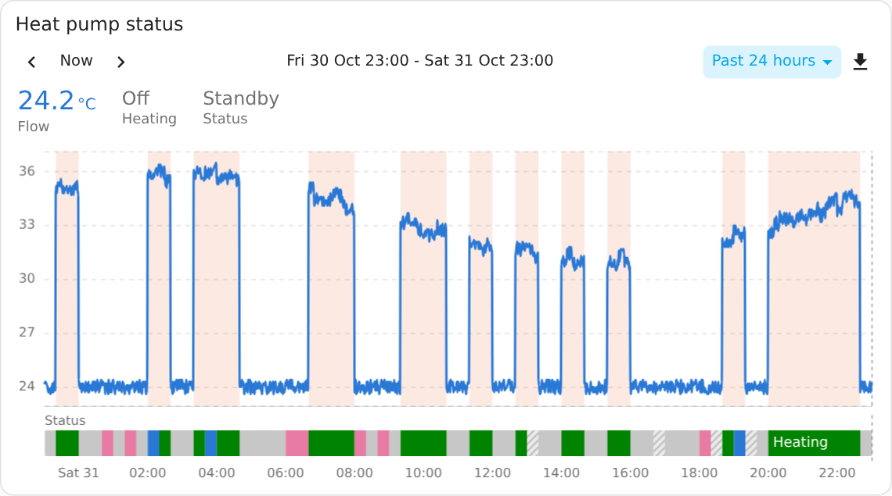
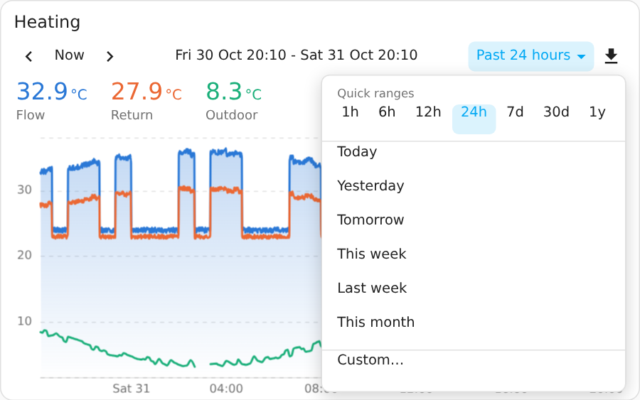
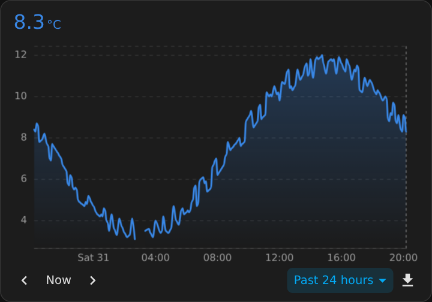
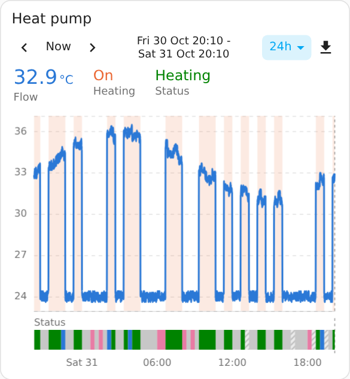
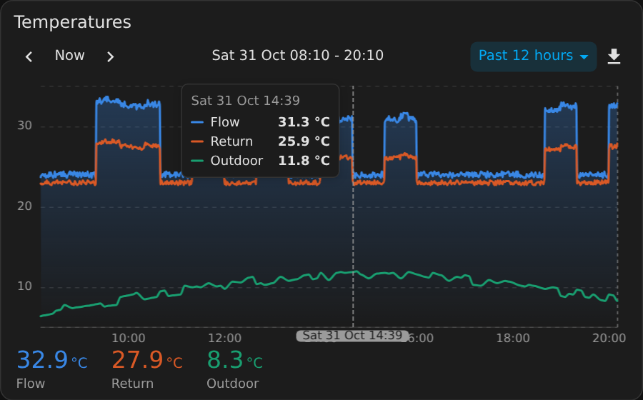

# Using the card

## Toolbar

One row, at the top or bottom of the card (`toolbar_position`).

| Control | What it does |
|---|---|
| ‹ › | Moves the window by its own length. Calendar windows move by calendar period (This month goes back to the whole of last month); rolling, custom and zoomed windows move by their exact duration. Stepping forward onto the present makes a rolling window live again. |
| Now | A window of the same length ending now, or the current period for a calendar preset. |
| Range label | The window shown, for example `Mon 26 Oct 00:00 - Sun 1 Nov 23:59`. Click it to type a custom range. |
| Presets | A menu. At its top, the quick ranges 1h 6h 12h 24h 7d 30d 1y: rolling windows ending now (set them with `quick_ranges`). Below them the menu entries, by default Today, Yesterday, Tomorrow, This week, Last week, This month, Last month, This year and Last year (set them with `presets`; lengths show as "Past 6 days"). Custom… at the end opens From and To date-and-time fields. The button shows the window picked, such as "Past 24 hours" or "Today". |
| Download | CSV of what is shown, or a PNG image. |

With `toolbar_position: bottom` the toolbar sits under the chart and the menu opens upwards. Here with the dates and names turned off, in a dark theme:

On a narrow card the toolbar stays on one row: first the range label goes onto two lines, then the menu button names the window briefly (24h instead of Past 24 hours), then the label is cut short. With the range label turned off, its space stays empty. The menu stays inside the card: the quick ranges stay at its top and the entries scroll.

Weeks start on the day set in your Home Assistant profile (**First day of the week**). With "Auto", the card follows the browser's language settings.

## Values above the chart

Each entity shows its value in its line's colour, with its name underneath (or above, left or right of it, with `value_position`). An entity with states shows the state as Home Assistant writes it, such as "Standby", in that state's colour.

- Tap a value to open the entity's details (more-info).
- Tap a name to fade the line, bars or strip (drawn at `faded_opacity`, 10 % by default) and strike the name through. Tap again to bring it back. Faded entities are left out of the CSV, and out of a pie.
- While you hover over or tap the chart, the values change to the readings at that moment, and a vertical line shows the time on the axis. With the floating tooltip on (`tooltip: true`), the tooltip shows those readings and the values row keeps the current ones:

  

- In a bar chart a meter shows the total of the bars on screen; while you hover, the bar under the cursor. In a pie, each value shows its share. Over a heatmap, the value is that of the hour under the cursor.
- `show_names: false` (or `show_name: false` on one entity) shows the values without names; hovering a value then shows whose it is. Without its name, an entity cannot be faded by tapping.

## Moving and zooming

- Drag sideways to move the time window earlier or later. The chart follows as you drag, and data for parts not loaded yet is fetched while you drag. The card loads half a window extra on each side, so short drags need no new request.
- Pinch on a touch screen, or hold Ctrl and use the mouse wheel (a trackpad pinch does the same), to zoom around your fingers or the pointer. The chart redraws as you zoom. Plain scrolling still scrolls the page.
- Hold Shift and drag to select a part to zoom into. With `drag_action: zoom`, a plain drag selects instead of moving.
- Double-click or double-tap to go back to the window picked in the toolbar.
- On touch screens a vertical swipe still scrolls the dashboard.
- Pies have no time axis, so dragging and zooming do nothing there; the toolbar picks their window.

## Dates, times and numbers

The card follows the settings in your Home Assistant profile:

- **Language:** the date style and the names of months and weekdays.
- **Time format:** a 12- or 24-hour clock, set directly or following the language or the device.
- **Number format:** the decimal mark and the thousands separator.
- **First day of the week:** where weeks start, for This week, Last week and weekly bars.

Times are shown in the device's own time zone, so someone in New York sees New York times wherever Home Assistant runs. The card writes month names, so the profile's separate date format setting does not apply, and it does not use the profile's option to show the server's time zone.

| Profile | Toolbar | Time axis | Numbers |
|---|---|---|---|
| English (US) | Tue, Oct 27 8:05 PM | Tue 27, 6:00 AM | 1,234.5 |
| English (UK) | Tue 27 Oct 20:05 | Tue 27, 06:00 | 1,234.5 |
| German | Di., 27. Okt. 20:05 | Di., 27., 06:00 | 1.234,5 |

The CSV always writes times as `YYYY-MM-DD HH:mm:ss` on a 24-hour clock, so spreadsheets read them the same everywhere; `csv_separator` and `csv_decimal` set its separator and decimal mark.

## Loading

A thin bar runs along the top of the chart while data loads, and the old lines stay visible but dimmed. After 3 seconds the chart also says "Loading…". If loading fails, a message with a Retry button appears.
